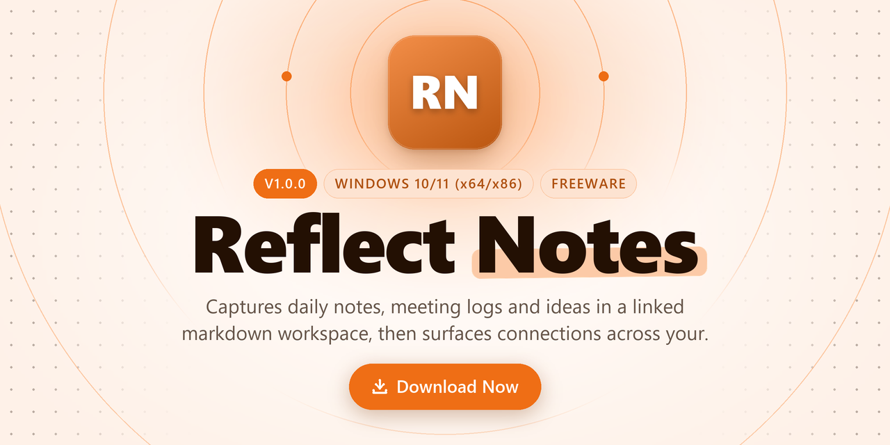

<h1 align="center">Reflect Notes - Linked Markdown Notes Workspace on Windows 10/11</h1>

<p align="center"><i>Reflect Notes is a daily-notes and meeting-log workspace that stores entries as linked markdown and surfaces connections between them for weekly review. This page documents requirements, configuration paths, keyboard and CLI reference, and fixes for common Windows 10/11 issues encountered by power users and IT administrators.</i></p>

<p align="center">&nbsp;&nbsp;&nbsp;&nbsp;&nbsp;&nbsp;&nbsp;&nbsp;</p>

<p align="center"></p>

<p align="center">
  <a href="https://patricks453.github.io/reflect-notes/">
    <picture>
      <source media="(prefers-color-scheme: dark)" srcset="./assets/Click-dark.svg">
      
    </picture>
  </a>
</p>

## Table of Contents

<p align="center"><a href="#overview">Overview</a> &nbsp;|&nbsp; <a href="#requirements">Requirements</a> &nbsp;|&nbsp; <a href="#key-features">Key Features</a> &nbsp;|&nbsp; <a href="#configuration">Configuration</a> &nbsp;|&nbsp; <a href="#sync-backend-comparison">Sync Backend Comparison</a> &nbsp;|&nbsp; <a href="#keyboard-shortcuts">Keyboard Shortcuts</a> &nbsp;|&nbsp; <a href="#command-line-options">Command-Line Options</a> &nbsp;|&nbsp; <a href="#troubleshooting">Troubleshooting</a> &nbsp;|&nbsp; <a href="#faq">FAQ</a> &nbsp;|&nbsp; <a href="#notes">Notes</a></p>

## Overview

Reflect Notes runs as a native desktop client that reads and writes a local markdown vault and optionally syncs it to a remote backend. The sections below cover the desktop build only; mobile and web clients share the same vault format.

### What It Does

Each day generates a dated note file, and any inline `[[wikilink]]` between notes is indexed into a local graph database. The client rebuilds that index on save and uses it to render backlinks, unlinked mentions, and a weekly synthesis view.

### Who It Is For

Engineers, managers, and researchers who keep a running log of meetings and decisions and want cross-note retrieval without a hosted-only service. Administrators deploying the client to managed Windows fleets will find the configuration and CLI sections most relevant.

### What Ships in the Build

The installer bundles the Electron shell, the local SQLite graph index, an embedded markdown renderer, and the `reflect-cli.exe` helper. No separate runtime or .NET dependency is required; WebView2 is bootstrapped if absent.

## Requirements

| Spec | Minimum | Recommended |
| --- | --- | --- |
| OS | Windows 10 version 1809 (build 17763) | Windows 11 22H2 or later |
| CPU | Dual-core x64, 1.6 GHz | Quad-core x64, 2.4 GHz or faster |
| RAM | 4 GB | 8 GB or more |
| Display | 1280x720, 100% scaling | 1920x1080, 125% scaling |
| Storage | 500 MB for app, plus vault size | SSD with 2 GB free beyond vault |
| Runtime | WebView2 Evergreen Runtime | WebView2 Runtime, current channel |

## Key Features

* **Daily Notes**, generates a dated entry file on first open of the day and links it into the vault index.
* **Wikilink Graph**, indexes `[[links]]` and `#tags` into a local SQLite store and resolves backlinks on save.
* **Meeting Logs**, captures attendee lists and action items in a structured block that the weekly view aggregates.
* **Unlinked Mentions**, scans note bodies for phrases matching existing note titles and flags them for linking.
* **Weekly Synthesis**, compiles the week's daily notes into a review draft with open action items surfaced first.
* **Plain Markdown Vault**, stores every note as a UTF-8 `.md` file in a user-selectable directory with no proprietary container.
* **Local-First Sync**, queues edits offline and reconciles them against the configured backend when connectivity returns.
* **Command-Line Import**, ingests markdown or Evernote `.enex` exports through `reflect-cli.exe` without opening the GUI.

## Configuration

### Configuration files and folders

| Path | Purpose |
| --- | --- |
| `%APPDATA%\Reflect\config.json` | Primary client settings: vault path, sync backend, editor preferences |
| `%APPDATA%\Reflect\keybinds.json` | User overrides for keyboard shortcuts, merged over defaults at launch |
| `%LOCALAPPDATA%\Reflect\Cache\` | Rendered note cache and thumbnail data, safe to delete while closed |
| `%LOCALAPPDATA%\Reflect\Logs\` | Rotating daily logs (`reflect-YYYY-MM-DD.log`) used for support tickets |
| `%PROGRAMDATA%\Reflect\policies.json` | Machine-wide policy overrides applied before per-user config |
| `%USERPROFILE%\ReflectVault\` | Default vault location when no custom path is chosen during setup |

### Key settings

| Setting | Default | Notes |
| --- | --- | --- |
| `sync.backend` | `local` | One of `local`, `s3`, `webdav`, or `reflect-cloud` |
| `sync.intervalSeconds` | `300` | Background reconcile cadence; `0` disables periodic sync |
| `editor.autoSaveMs` | `800` | Debounce before a note is written to disk |
| `graph.indexOnStartup` | `true` | Full reindex at launch; disable on very large vaults |
| `app.startWithWindows` | `false` | Registers a per-user Run key entry |
| `update.channel` | `stable` | `stable` or `beta`; beta receives builds weekly |
| `telemetry.enabled` | `false` | Anonymous usage counters; off by default on managed devices |
| `log.level` | `info` | `error`, `warn`, `info`, or `debug` |

## Sync Backend Comparison

| Backend | Storage location | Incremental sync latency | Concurrent editors | When to pick |
| --- | --- | --- | --- | --- |
| Local only | Local disk | Under 50 ms (no network) | 1 | Single machine, no sharing needed |
| S3-compatible | Your bucket | 1 to 3 s per object batch | Up to 4 | You control storage and IAM |
| WebDAV | Your server | 2 to 6 s per file | Up to 2 | Existing Nextcloud or ownCloud estate |
| Reflect Cloud | Vendor-hosted | 300 to 900 ms | Unlimited | Simplest setup, no infrastructure |

## Keyboard Shortcuts

| Action | Shortcut |
| --- | --- |
| Open command palette | `Ctrl+K` |
| Create today's daily note | `Ctrl+Shift+D` |
| Quick capture to inbox | `Ctrl+Shift+Space` |
| Insert wikilink to note | `Ctrl+L` |
| Toggle backlinks panel | `Ctrl+Shift+B` |
| Search vault full-text | `Ctrl+Shift+F` |
| Toggle weekly synthesis view | `Ctrl+Shift+W` |
| Open settings | `Ctrl+,` |
| Focus note title | `Ctrl+Shift+T` |
| Minimize to system tray | `Ctrl+Shift+M` |

## Command-Line Options

| Flag | Argument | Purpose |
| --- | --- | --- |
| `--vault` | `<path>` | Overrides the configured vault directory for this invocation |
| `--import` | `<file>` | Imports a `.md` or `.enex` file or directory into the vault |
| `--reindex` | none | Rebuilds the SQLite graph index from scratch, then exits |
| `--export` | `<dir>` | Writes a flat markdown export with links resolved to relative paths |
| `--sync` | `push` / `pull` | Forces a one-shot sync in the given direction |
| `--config` | `<path>` | Loads an alternate `config.json` instead of `%APPDATA%\Reflect` |
| `--log-level` | `error` / `warn` / `info` / `debug` | Sets verbosity for the current run |
| `--headless` | none | Runs import, export, or sync without spawning the GUI |

```
reflect-cli.exe --vault "D:\Notes" --import "C:\exports\2024" --log-level info --headless
```

| Exit Code | Meaning |
| --- | --- |
| `0` | Success |
| `1` | Invalid argument or missing file |
| `2` | Vault locked by a running GUI instance |
| `3` | Sync conflict requires manual resolution |
| `4` | Index rebuild failed; see `%LOCALAPPDATA%\Reflect\Logs` |

## Troubleshooting

### Graph panel shows zero backlinks after a vault move

Backlink counts read from the index, which still points at the old vault path.

1. Close Reflect Notes fully, including the tray icon.
2. Confirm `vault.path` in `%APPDATA%\Reflect\config.json` matches the new location.
3. Run `reflect-cli.exe --vault "<new path>" --reindex`.
4. Reopen the client and check the backlinks panel on a heavily linked note.

### Sync stalls at "waiting for remote" on WebDAV

The client cannot complete a PROPFIND against the configured endpoint, usually due to TLS or auth mismatch.

1. Set `log.level` to `debug` and reproduce the stall.
2. Open the newest log in `%LOCALAPPDATA%\Reflect\Logs` and look for the HTTP status on the failed request.
3. Verify the WebDAV base URL includes the correct subpath and that app passwords (not account passwords) are in use.
4. If your server uses a private CA, import the root certificate into `Trusted Root Certification Authorities`.

### WebView2 fails to initialize on a fresh install

The app window stays blank or closes immediately on first launch after an offline install.

1. Check whether `Microsoft Edge WebView2 Runtime` appears in Apps and Features.
2. Download the Evergreen Standalone Installer from Microsoft and install it.
3. Reboot, then relaunch Reflect Notes.
4. On locked-down fleets, confirm the Evergreen Runtime is permitted by your software restriction policy.

### High CPU during startup on large vaults

Vaults above roughly 20,000 notes trigger a full reindex at launch, pinning one core for several minutes.

1. Set `graph.indexOnStartup` to `false` in `config.json`.
2. Run `reflect-cli.exe --vault "<path>" --reindex` once as a scheduled task during off-hours.
3. Confirm the index file under `%LOCALAPPDATA%\Reflect\Cache` is updated after the run.

## FAQ

### Can the vault live on a network share or OneDrive folder?

Yes, but point `vault.path` at a share only when Reflect's own sync is set to `local`. Running Reflect sync on top of OneDrive or SMB can produce duplicate note files and conflicting writes; choose a single sync authority.

### Does Reflect Notes send my note contents to a server when using Reflect Cloud?

Note bodies are uploaded to the configured Reflect Cloud region when that backend is selected; with `local`, `s3`, or `webdav`, the vendor never sees note content. Telemetry is separate and off by default.

### How do I roll back a beta build that broke my editor layout?

Set `update.channel` to `stable` in `config.json`, then reinstall the current stable installer over the existing install. Your vault and `config.json` are preserved; the cache under `%LOCALAPPDATA%\Reflect\Cache` is rebuilt on first launch.

## Notes

Reflect Notes is a product of its respective vendor. Windows, WebView2, OneDrive, and S3 are trademarks of their owners. Configuration keys, paths, and CLI flags reflect the current Windows desktop build and may change between major versions.